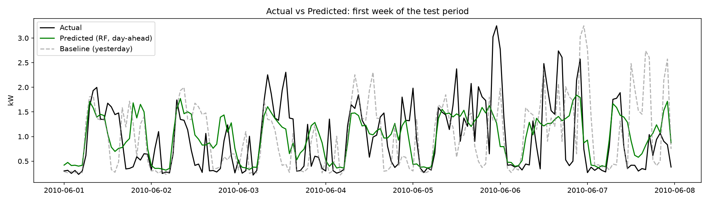
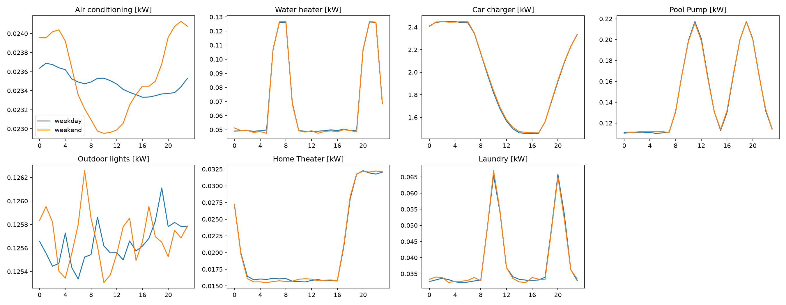
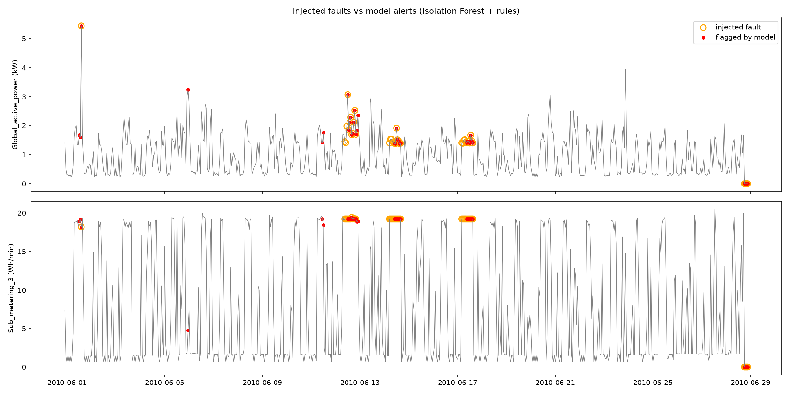

# HASS AI Add-ons

**HASS (Home Automation Smart System)** is an ESP32 smart-home project with a Flutter app and a Firebase Realtime Database. This repository adds machine-learning features on top of it: consumption forecasting, a bill estimate, appliance fault detection, and usage-habit suggestions.

Most of the project is classical machine learning (Random Forest, Isolation Forest, KMeans). The only deep-learning model is a small Keras network, saved as `forecast_model.h5`.

| Feature | Task | Status |
|---|---|---|
| Energy data cleaning and exploration | 1 | done |
| Consumption forecast and monthly bill estimate | 2 | done |
| Appliance fault detection and usage-habit suggestions | 3 | done (faults are simulated) |
| Voice control (English, then Arabic) | 4, 5 | not started |
| Firebase logger, voice-to-relay bridge, README and slides | 6 | not started |

**Contents:** [Quick start](#quick-start) · [Layout](#repository-layout) · [Models](#models-and-file-formats) · [Datasets](#datasets) · [Task 1](#task-1-clean-and-explore-the-energy-data) · [Task 2](#task-2-consumption-forecast-and-bill-estimate) · [Task 3](#task-3-fault-detection-and-habit-suggestions) · [Tests](#tests) · [Honest reporting](#honest-reporting) · [Next steps](#next-steps)

---

## Quick start

```bash
mamba env create -f environment.yml
conda activate hass-ai
pip install tensorflow h5py
```

TensorFlow is installed with pip because the conda-forge build did not resolve for Python 3.11 on Windows. It is needed only for the Keras model.

Download the datasets (see [Datasets](#datasets)) into the folders shown in the layout. Then run the pipeline in this order:

1. Run `energy/01_clean_explore.ipynb`. It creates `energy/clean_energy.csv`.
2. Train the models from the `energy/` folder:
   ```bash
   cd energy
   python train_forecast.py     # Random Forest for Task 2
   python train_anomaly.py      # Isolation Forest + rules + habit KMeans for Task 3
   ```
3. Run the tests:
   ```bash
   python test_forecast.py
   python test_anomaly.py
   ```
4. Open `02_forecast.ipynb` and `03_anomaly_habits.ipynb` to see the results and plots. They call the scripts above.

The scripts find the data from their own location, so the folder you run them from does not matter.

---

## Repository layout

```
hass-ai/
  energy/                          Tasks 1-3
    01_clean_explore.ipynb         Task 1: cleaning and exploration (writes clean_energy.csv)
    02_forecast.ipynb              Task 2: experiments, results, plots
    03_anomaly_habits.ipynb        Task 3: experiments, results, plots
    clean_energy.csv               hourly table from Task 1 (input of Tasks 2 and 3)
    config.json                    electricity tariff tiers (edit to match your bill)
    predict.py                     Task 2: forecast the next 24 hours, monthly_bill()
    train_forecast.py              Task 2: trains the Random Forest and saves it
    test_forecast.py               Task 2: tests
    anomaly_habits.py              Task 3: detect(), suggest_rules(), shared feature code
    train_anomaly.py               Task 3: trains the fault detector and habit KMeans
    test_anomaly.py                Task 3: tests
    forecast_model.h5              Task 2 Keras network (deep learning, kept for the report)
    forecast_scaler.joblib         scaler for the Keras network
    forecast_model.joblib          Task 2 Random Forest (large, generated, not committed)
    anomaly_model.joblib           Task 3 detector (generated, not committed)
    habit_kmeans.joblib            Task 3 habit KMeans models (generated, not committed)
  Augmented Smart Home with Weather Information/   raw data (Mendeley)
  individual+household+electric+power+consumption/ raw data (UCI)
  speech_commands/, arabic-speech-commands-dataset-v1.0/   voice datasets (Tasks 4-5)
  environment.yml
  README.md
  .gitignore
```

Raw data and generated models are not committed (see `.gitignore`). The small files (`clean_energy.csv`, `config.json`, `forecast_model.h5`) can be committed. Generated `.joblib` files are rebuilt by the training scripts.

---

## Models and file formats

| File | Model | Why this format |
|---|---|---|
| `forecast_model.h5` | Keras network (Dense 64 → 32 → 1) | `.h5` is the Keras format. It is the only deep-learning model in the project. |
| `forecast_model.joblib` | Random Forest (day-ahead forecast) | `.joblib` is the standard format for scikit-learn models. Keras cannot save them to `.h5`. |
| `anomaly_model.joblib` | Isolation Forest + rule thresholds | Same reason. |
| `habit_kmeans.joblib` | KMeans per device | Same reason. |

The Random Forest is the forecast that `predict.py` uses. The Keras network is kept as the deep-learning comparison requested in the project brief.

---

## Datasets

| Dataset | Used by | Link | License / credit |
|---|---|---|---|
| Individual Household Electric Power Consumption (UCI) | Tasks 1, 2, 3 | https://archive.ics.uci.edu/dataset/235 | Hebrail and Berard |
| Augmented Smart Home with Weather Information (Mendeley Data) | Task 3 (habits) | https://data.mendeley.com/datasets/pxnb7gh646/1 | CC0 |
| Smart Home Dataset with Weather Information (Kaggle, taranvee), optional | Task 1 (second look) | https://www.kaggle.com/datasets/taranvee/smart-home-dataset-with-weather-information | see Kaggle page |
| Google Speech Commands v0.02 | Tasks 4, 5 | https://huggingface.co/datasets/google/speech_commands | CC BY 4.0 |
| Arabic Speech Commands | Tasks 4, 5 | https://zenodo.org/records/4662481 | CC BY 4.0 |

Each energy dataset is a different house, so they are never merged. Every model is trained on one dataset.

---

## Task 1: Clean and explore the energy data

**Goal.** One clean, documented hourly file that Tasks 2 and 3 use.

**Dataset.** UCI Individual Household Electric Power Consumption: one house in France, one reading per minute, December 2006 to November 2010.

**Cleaning decisions**
1. The file is semicolon-separated and uses `?` for missing values.
2. `Date` and `Time` are combined into one datetime index (day first).
3. 25,979 minute rows (1.25%) are missing, the same count in each of the seven measurement columns.
4. Resampled from one minute to one hour (mean): 34,589 hours in the range, 421 of them without any reading.
5. Gaps of 3 hours or less are forward-filled (1 hour affected). Longer gaps are dropped (420 hours). Result: **34,169 hours** from 2006-12-16 17:00 to 2010-11-26 21:00, no missing values.
6. Added features: `unmetered`, `hour`, `weekday` (0 = Monday), `month`, `is_weekend`.

**Data dictionary**

| Column | Unit | Meaning |
|---|---|---|
| `datetime` (index) | | start of the hour |
| `Global_active_power` | kW | household active power, hourly mean |
| `Global_reactive_power` | kW | household reactive power, hourly mean |
| `Voltage` | V | hourly mean voltage |
| `Global_intensity` | A | hourly mean current |
| `Sub_metering_1` | Wh per minute | kitchen (dishwasher, oven, microwave), hourly mean |
| `Sub_metering_2` | Wh per minute | laundry room (washing machine, dryer, refrigerator, lights), hourly mean |
| `Sub_metering_3` | Wh per minute | electric water heater and air conditioner, hourly mean |
| `unmetered` | Wh per minute | `Global_active_power * 1000 / 60` minus the three sub-meters |
| `hour` | 0-23 | hour of day |
| `weekday` | 0-6 | day of week, 0 = Monday |
| `month` | 1-12 | calendar month |
| `is_weekend` | 0 or 1 | 1 on Saturday and Sunday |

The findings (daily and weekly profiles, seasonal trend, correlations) are in the last analysis cell of `01_clean_explore.ipynb`.

---

## Task 2: Consumption forecast and bill estimate

**Goal.** Forecast household consumption for the next 24 hours, and turn it into a monthly bill estimate.

**Data.** `energy/clean_energy.csv`. Target: `Global_active_power` (kW, hourly mean, so numerically kWh per hour).

**Method**
1. The hours removed in Task 1 are put back as missing, so "24 hours ago" really means the same hour yesterday.
2. Features use only the calendar and past values of the target: `hour`, `weekday`, `is_weekend`, lags 24, 48, 168, and rolling means of the 24 and 168 hours that end 24 hours back. The other columns of the file are measured in the hour being predicted, so using them would leak the answer.
3. Time-based split, never random. Train: before 2009-12-01. Validation: 2009-12-01 to 2010-05-31. Test: from 2010-06-01 to the end of the data.
4. Baselines first. Random Forest and XGBoost with a small grid tuned on validation only. Final models are retrained on train + validation, and the test set is evaluated once.
5. The forecast for the next 24 hours needs lags of at least 24 hours, because the last 23 hours are unknown when forecasting a full day. The published model is therefore a **day-ahead** Random Forest.

**Results (test set, day-ahead model)**

| Model | MAE (kW) | RMSE (kW) |
|---|---|---|
| Baseline: same hour yesterday | 0.4870 | 0.7335 |
| Baseline: same hour last week | 0.5425 | 0.7886 |
| **Random Forest, day-ahead (published)** | **0.4234** | **0.5767** |

It beats the yesterday baseline by about 13% (MAE) and 21% (RMSE). Most important features: `lag_168` (36%), `hour` (19%), `lag_24` (14%), `roll_168` (10%), `roll_24` (8%), `lag_48` (8%).

**Next-hour model (secondary result).** It uses the previous hour as its main input, so compare it with the previous-hour baseline only.

| Model | MAE (kW) | RMSE (kW) |
|---|---|---|
| Baseline: previous hour | 0.3810 | 0.5769 |
| Random Forest | 0.3169 | 0.4608 |
| XGBoost | 0.3144 | 0.4595 |

The validation period (December to May) has higher and less regular consumption, so its errors are higher than on the test set.



**Monthly bill estimate.** Over the first 30 days of the test period, the model predicted **728.4 kWh** against **698.1 kWh** actual (4.3% error). With the tiered tariff in `config.json`, this is **1,275.20 EGP predicted vs 1,204.10 EGP actual** (5.9% error). Fixed fees are not included. The data is from a French house and the tariff is an Egyptian table, so the amount illustrates the method and is not a real bill.

**Run**

```bash
cd energy
python predict.py path/to/history.csv
```

The CSV needs the time as its first column, a `Global_active_power` column (kW), hourly rows, and at least 192 hours of history. It prints the next 24 hours.

From Python:

```python
from predict import predict, monthly_bill, load_config
forecast = predict(history)           # pandas Series, 24 hourly values in kW
bill = monthly_bill(kwh, load_config()["tiers"])
```

**Limitations**
- One home, about four years of data, recorded in France.
- No weather features. The UCI data has none.
- The tariff in `config.json` is approximate. Edit it to match your bill.
- A model trained on the UCI house will not fit the HASS home. It must be retrained on data logged from the real hardware (Task 6).

---

## Task 3: Fault detection and habit suggestions

Functions: `energy/anomaly_habits.py`. Training: `energy/train_anomaly.py`.

### A. Habit suggestions

**Data.** Augmented Smart Home with Weather Information (Mendeley), hourly, 8,399 rows. It has per-device `[kW]` columns, which the UCI data does not have.

**Findings**
- Air conditioning correlates 0.99 with temperature and varies only 2% over the day. It is driven by temperature, not by a usage habit, so it is excluded from the suggestions. Outdoor lights are flat and are excluded too.
- KMeans (k from 2 to 5) on each device's 24-hour profile gives silhouette scores of 0.05 to 0.16. The days do not form clear groups, so the suggestions come from each device's **average daily profile**. The KMeans models are saved only because the task asks for them.
- Weekday and weekend profiles are almost identical, so every suggestion applies to every day.

**Rule.** A device "peaks" in the hours where its average load is above the midpoint between its lowest and highest hourly average.



**Suggestions produced by `suggest_rules(df)`** (8 in total):
- Water heater peaks from 06:00 to 09:00 and from 20:00 to 23:00 every day.
- Pool Pump peaks from 09:00 to 14:00 and from 17:00 to 22:00 every day.
- Laundry peaks from 10:00 to 12:00 and from 20:00 to 22:00 every day.
- Home Theater peaks from 18:00 to 01:00 (next day) every day.
- Car charger peaks from 21:00 to 10:00 (next day) every day.

**Caveat.** The per-device columns look synthetic: the car charger averages 2.0 kW, more than the whole-house mean of 0.86 kW, and the daily curves repeat almost identically. Treat the suggestions as a demonstration of the method, not as measurements of a real home.

### B. Fault detection

**Data.** `energy/clean_energy.csv` (UCI, 34,169 hours). The first 70% is used for training and the last 30% for testing.

**No real faults exist in the data.** 40 faults were injected into a copy of the test set:
- 20 spikes: one hour with 4 kW added to total consumption.
- 10 stuck-on faults: `Sub_metering_3` held at its 99th percentile for 12 hours.
- 10 outages: total consumption and all sub-meters set to zero from 18:00 to 21:00.

An event counts as detected when at least one of its hours is flagged.

**Model.** Isolation Forest (300 trees, contamination 0.01) plus three rules. An hour is flagged if the Isolation Forest or any rule fires. Rule thresholds come from the normal training data only (0.1% and 99.9% quantiles).

| Rule | Fires when | Targets |
|---|---|---|
| `low_power` | consumption falls far below the usual level for that hour | outages |
| `power_jump` | consumption is far above the usual level for that hour | spikes |
| `stuck_high` | `Sub_metering_3` stays above its limit for 6 hours | stuck-on devices |

**Why the rules.** The Isolation Forest alone missed every outage (0/10). The training data never drops to zero, and tree models do not extrapolate, so a zero looks normal to them.

| Method | Precision | Recall (hours) | False-alarm rate | Spikes | Stuck-on | Outages |
|---|---|---|---|---|---|---|
| Isolation Forest only | 0.259 | 0.167 | 0.009 | 19/20 | 5/10 | 0/10 |
| Rule `low_power` only | 1.000 | 0.222 | 0.000 | 0/20 | 0/10 | 10/10 |
| Rule `power_jump` only | 0.933 | 0.078 | 0.0001 | 14/20 | 0/10 | 0/10 |
| Rule `stuck_high` only | 0.222 | 0.400 | 0.025 | 0/20 | 10/10 | 0/10 |
| **Isolation Forest + rules (published)** | **0.295** | **0.728** | **0.031** | **19/20** | **10/10** | **10/10** |

**39 of 40 faults are detected.** The false-alarm rate is 3.1% of normal hours, about 0.75 false alarms per day, mostly from the `stuck_high` rule. Precision is low because faults are only 1.76% of the hours.



**Run**

```bash
cd energy
python anomaly_habits.py detect path/to/hourly.csv
python anomaly_habits.py habits path/to/habits_hourly.csv
```

From Python: `detect(df)` returns one row per hour with `anomaly`, `score`, `iso`, `has_context` and one column per rule. `suggest_rules(df)` returns the suggestions as text.

**Limitations**
- The faults are simulated and their shapes were chosen by us. The results show that faults of these shapes can be detected, not that real faults will be.
- The spike size was changed from "multiply by 4" to "add 4 kW" after the first run. Rules and features were chosen by looking at results on the same test set, so the numbers are optimistic. A separate validation split is the next step.
- The false-alarm rate of 3.1% can be lowered by tuning the `stuck_high` limit on validation data.
- The detector uses UCI columns that the HASS hardware does not produce. It must be retrained on data logged from the real device (Task 6).

---

## Tests

| Script | What it checks |
|---|---|
| `test_forecast.py` | the forecast has 24 values with no missing values; too-short history is rejected; the bill matches the tiers (50 kWh = 34.00 EGP, 100 kWh = 77.50 EGP) |
| `test_anomaly.py` | `detect()` returns the expected columns; `suggest_rules()` returns suggestions in the expected format |

The training scripts print the results. On the UCI data they should match the tables above: test MAE 0.4234 for the forecast, and 444 flagged test hours with precision 0.295 and recall 0.728 for the detector.

---

## Honest reporting

- **Simulated:** all faults used to evaluate the fault detector (Task 3).
- **Possibly synthetic:** the per-device `[kW]` columns of the Mendeley dataset (Task 3).
- **Public data:** everything else (UCI, Mendeley, Kaggle, Google Speech Commands, Arabic Speech Commands).
- **Not yet used:** data logged from the real HASS hardware (Firebase), planned for Task 6.

---

## Next steps

- **Task 6:** log real HASS data (temperature, humidity, relay states) and retrain the Task 2 and Task 3 models on it.
- **Recommendations:** keep a log of each suggestion (ID, date, type, device, text, status) and measure whether the device usage in the suggested hours changes. The real relay states from Task 6 are the reliable source for this.
- **Validation split** for the fault detector, to tune the rule thresholds without using the test set.
- **Tasks 4 and 5:** voice dataset and voice-command model.