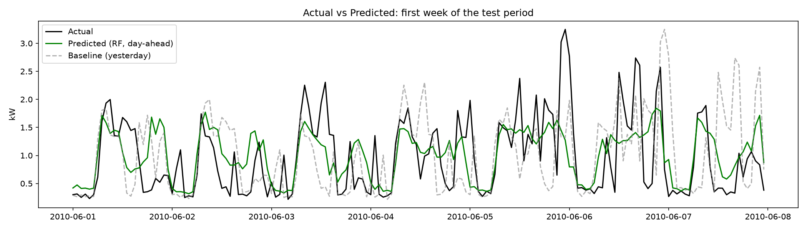
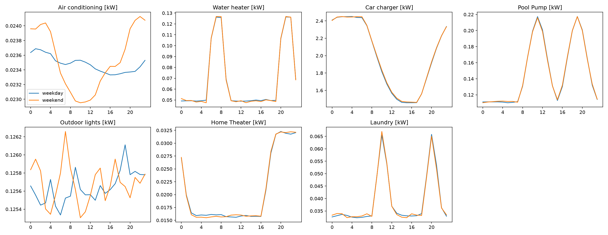
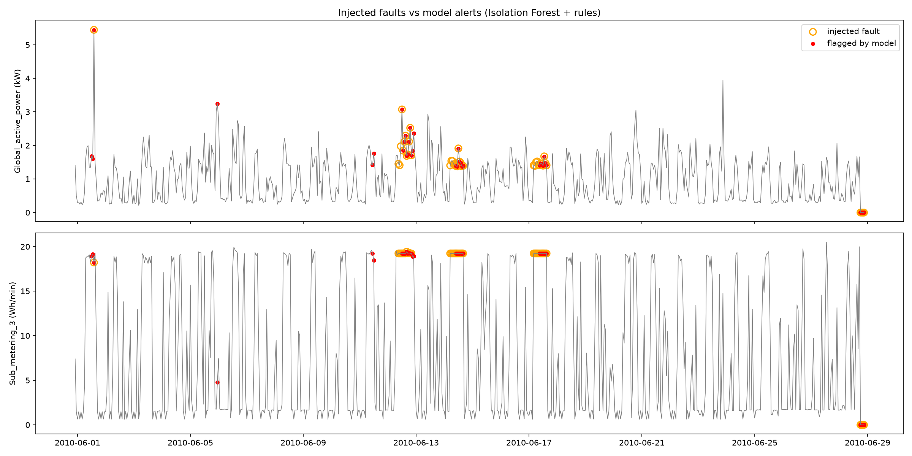

# HASS AI Add-ons

**HASS (Home Automation Smart System)** is an ESP32 smart-home project with a Flutter app and a Firebase Realtime Database. This repository holds the AI add-ons built on top of it.

| Feature | Task | Status |
|---|---|---|
| Energy data cleaning and exploration | 1 | cleaning pipeline done, deliverables pending (see Task 1) |
| Consumption and bill forecasting | 2 | done |
| Appliance fault detection and usage-habit learning | 3 | done |
| Voice control (English, then Arabic) | 4, 5 | not covered in this README yet |
| Firebase integration, logger, slides | 6 | not covered in this README yet |

**Contents:** [Layout](#repository-layout) · [Setup](#setup) · [Datasets](#datasets) · [Task 1](#task-1-clean-and-explore-the-energy-dataset) · [Task 2](#task-2-consumption-and-bill-forecasting) · [Task 3](#task-3-fault-detection-and-usage-habit-learning) · [What is simulated](#honest-reporting-what-is-simulated-and-what-is-public)

---

## Repository layout

```
hass-ai/
  energy/                         Tasks 1-3: notebooks, scripts, models
    02_forecast.ipynb             Task 2 notebook
    03_anomaly_habits.ipynb       Task 3 notebook
    predict.py                    next-24-hour forecast (function + command line)
    anomaly_habits.py             detect(df) and suggest_rules(df)
    forecast_model.joblib         Task 2 model
    anomaly_model.joblib          Task 3 fault detector (Isolation Forest)
    habit_kmeans.joblib           Task 3 KMeans models (see Task 3, they are not used for the suggestions)
    config.json                   electricity tariff tiers
    *.png                         figures used in this README
  Augmented Smart Home with Weather Information/   raw data (Mendeley)
  individual+household+electric+power+consumption/ raw data (UCI)
  speech_commands/, arabic-speech-commands-dataset-v1.0/   voice datasets (Tasks 4-5)
  environment.yml
  README.md
```

Files that the notebooks generate (hourly CSVs) are written to `data_clean/` next to the repository and are not committed.

## Setup

```bash
mamba env create -f environment.yml
conda activate hass-ai
```

Manual alternative (energy tasks):

```bash
mamba create -n hass-ai python=3.11 -y
conda activate hass-ai
mamba install -c conda-forge numpy pandas matplotlib seaborn scikit-learn scipy statsmodels xgboost lightgbm joblib jupyterlab ipykernel -y
```

Open the notebooks from the `energy/` folder and use **Restart Kernel and Run All**. The first cell of each notebook defines the paths (`DATA_DIR`, `OUT`); they currently point to `D:\Hass`, so change them to your clone path before running.

## Datasets

| Dataset | Used by | Link | License / credit |
|---|---|---|---|
| Individual Household Electric Power Consumption (UCI) | Tasks 1, 3 | https://archive.ics.uci.edu/dataset/235 | Hebrail and Berard |
| Augmented Smart Home with Weather Information (Mendeley Data) | Tasks 2, 3 | https://data.mendeley.com/datasets/pxnb7gh646/1 | CC0 |
| Smart Home Dataset with Weather Information (Kaggle, taranvee), optional | Task 1 second look | https://www.kaggle.com/datasets/taranvee/smart-home-dataset-with-weather-information | see Kaggle page |
| Google Speech Commands v0.02 | Tasks 4, 5 | https://huggingface.co/datasets/google/speech_commands | CC BY 4.0 |
| Arabic Speech Commands | Tasks 4, 5 | https://zenodo.org/records/4662481 | CC BY 4.0 |

Each energy dataset is a different house, so they are never merged: every model is trained on one dataset.

---

## Task 1: Clean and explore the energy dataset

**Goal.** One clean, documented hourly file of household consumption that the other energy tasks can use, and an understanding of how consumption behaves over the day, week and season.

**Dataset.** UCI Individual Household Electric Power Consumption: one house in France, one reading per minute, December 2006 to November 2010, 2,075,259 rows and 9 columns.

### Status

| Deliverable | Status |
|---|---|
| Cleaning pipeline | implemented and checked, inside `03_anomaly_habits.ipynb` (section B) |
| `clean_energy.csv` (shared hourly file) | **pending** |
| `01_clean_explore.ipynb`: daily and weekly profiles, monthly trend, correlation heatmap, 5 to 8 sentences of findings | **pending** |
| Data dictionary | below |

### Cleaning decisions (as implemented)
1. The file is semicolon-separated and uses `?` for missing values.
2. `Date` and `Time` are combined into one datetime index (day first, `dd/mm/yyyy`).
3. 25,979 minute rows (1.25%) are missing, with the same count in each of the seven measurement columns.
4. Data is resampled from one minute to one hour (mean): 34,589 hours in the range, 421 of them without any reading.
5. Gaps of 3 hours or less are forward-filled (this affected 1 hour); longer gaps are dropped (420 hours). Result: **34,169 hours** from 2006-12-16 17:00 to 2010-11-26 21:00, no missing values. The 420 dropped hours are gaps in the time index.
6. Added features: `hour`, `weekday` (0 = Monday), `is_weekend`, `unmetered`. Still to add for the final Task 1 file: `month`.

### Data dictionary

| Column | Unit | Meaning |
|---|---|---|
| `Date` | dd/mm/yyyy | date of the reading |
| `Time` | hh:mm:ss | time of the reading |
| `Global_active_power` | kW | household active power, minute average |
| `Global_reactive_power` | kW | household reactive power, minute average |
| `Voltage` | V | minute-average voltage |
| `Global_intensity` | A | minute-average current intensity |
| `Sub_metering_1` | Wh | kitchen (dishwasher, oven, microwave) |
| `Sub_metering_2` | Wh | laundry room (washing machine, dryer, refrigerator, lights) |
| `Sub_metering_3` | Wh | electric water heater and air conditioner |
| `unmetered` (derived) | Wh per minute | `Global_active_power * 1000 / 60 - Sub_metering_1 - Sub_metering_2 - Sub_metering_3`: consumption not covered by the three sub-meters |
| `hour`, `weekday`, `is_weekend` (derived) | | calendar features from the index |

In the hourly file every measurement column is the hourly mean of the per-minute values.

---

## Task 2: Consumption and bill forecasting

**Goal.** Forecast household consumption for the next 24 hours from past consumption and calendar features, and turn the forecast into an estimated monthly bill.

### Data
- **Augmented Smart Home with Weather Information** (Mendeley Data, CC0): one home, one reading per minute, 2016-01-01 05:00 to 2016-12-16 03:29 (503,910 rows).
- Target: `use_HO` (kW), treated as total household consumption (non-negative, mean 0.86 kW, maximum 14.7 kW). The sum of the per-device columns correlates only 0.66 with it, so this reading is plausible but not fully verified.
- This task uses the Mendeley dataset because the shared `clean_energy.csv` from Task 1 was not available yet. Once it exists, the same pipeline can be re-run on the UCI data as a comparison.

### Pipeline (`energy/02_forecast.ipynb`)
1. Keep the time, target and weather columns. Drop every per-device column (the devices add up to the target, so keeping them would leak it).
2. Convert time to a datetime index, make the columns numeric and resample to hourly means: 8,399 hourly rows, no gaps, no missing values.
3. Features: hour, weekday, is_weekend, lags of 24/48/168 hours and rolling means over 24 and 168 hours (computed on the lagged target, so the current hour never leaks). `month` is excluded because the test period covers November and December, which never appear in training.
4. Time-based split, never random. Train 2016-01-08 to 2016-09-04, validation to 2016-10-25, test 2016-10-25 to 2016-12-16 (1,235 hours).
5. Random Forest settings (300 trees, `min_samples_leaf=10`, `max_depth=15`) were tuned on validation only. Final models were retrained on train + validation and the test set was evaluated once.

### Results (test set)

**Day-ahead model (published, used by `predict.py`)**

| Model | MAE (kW) | RMSE (kW) |
|---|---|---|
| Baseline: same hour yesterday | 0.3743 | 0.5764 |
| Baseline: same hour last week | 0.3957 | 0.5962 |
| **Random Forest, no weather** | **0.2919** | **0.4341** |
| Random Forest, with weather | 0.2950 | 0.4372 |

The published model beats the yesterday baseline by about 22% (MAE) and 25% (RMSE). Most important features: `lag_24` (34%), `roll_24` (16%), `lag_168` (12%), `lag_48` (12%), `roll_168` (11%), `hour` (9%).

**Weather.** Adding weather helped slightly on validation (MAE 0.3138 vs 0.3197) and hurt slightly on test (0.2950 vs 0.2919), so it gives no consistent gain. The published model uses no weather, which also means HASS does not need weather forecasts.

**Next-hour model (secondary result)**

| Model | MAE (kW) | RMSE (kW) |
|---|---|---|
| Baseline: previous hour | 0.2405 | 0.3669 |
| Random Forest | 0.2134 | 0.3272 |
| XGBoost | 0.2133 | 0.3238 |

These models improve on the previous-hour baseline by about 11%. They rely heavily on `lag_1` (79.6% of importance), so compare them with the previous-hour baseline, not with the yesterday baseline, which predicts a longer horizon.



The model follows the daily rhythm but flattens sharp peaks.

### Monthly bill estimate
Over the first 30 days of the test period the model predicted **557.8 kWh** against **563.3 kWh** actual (1.0% error). With the tiered tariff in `energy/config.json` this is **890.04 EGP predicted vs 901.95 EGP actual** (1.3% error). Each tier is priced only for the kWh inside its range, and the small customer-service fee is not included. Hourly errors partly cancel when summed, so this is a monthly estimate, not hourly accuracy. Tariff prices and rules differ between sources and change over time: edit `config.json` to match your own bill.

### Run
```bash
cd energy
python predict.py path/to/history.csv
```
The CSV needs the time as the first column, a `use_HO` column (kW), hourly rows and at least 192 hours. It prints the next 24 hours of forecast. The output matches the notebook (maximum difference 4e-16).

### Limitations
- One home and about 11.5 months of data. The test period (November to December) is a season the model barely saw in training.
- Sharp peaks are under-predicted.
- Weather columns are same-hour measurements, not forecasts. The `temperature` column appears to be in degrees Fahrenheit.
- The tariff is configurable but approximate.
- `use_HO` as total consumption is an assumption (see Data).

---

## Task 3: Fault detection and usage-habit learning

Notebook: `energy/03_anomaly_habits.ipynb`. Functions: `energy/anomaly_habits.py`.

### A. Habit learning

**Data.** The same Mendeley dataset, hourly (8,399 rows). Here the per-device `[kW]` columns are used, because they are the subject of this task.

**Findings.**
- `Air conditioning [kW]` correlates 0.99 with temperature and varies only 2% over the day, so it is a function of temperature rather than a usage habit. `Outdoor lights [kW]` is flat (0.4% variation). Both are excluded.
- KMeans (k from 2 to 5) on each device's 24-hour daily profile (349 days) gives silhouette scores of 0.05 to 0.16 for the best k, so days do not form distinct groups, and the groups are not explained by weekends or temperature. The suggestions therefore come from each device's **average daily profile**, not from the clusters. The KMeans models are saved in `habit_kmeans.joblib` only because the task asks for them.
- Weekday and weekend profiles are nearly identical (maximum gap 0.02 to 0.05 of the device range, split threshold 0.2), so every suggestion applies to every day.

**Rule.** A device "peaks" during the hours where its average load is above the midpoint between its lowest and highest hourly average. No device drops to zero in this data, so "peak" is relative.



**Suggestions produced by `suggest_rules(df)`:**
- Water heater peaks from 06:00 to 09:00 and from 20:00 to 23:00 every day.
- Pool Pump peaks from 09:00 to 14:00 and from 17:00 to 22:00 every day.
- Laundry peaks from 10:00 to 12:00 and from 20:00 to 22:00 every day.
- Home Theater peaks from 18:00 to 01:00 (next day) every day.
- Car charger peaks from 21:00 to 10:00 (next day) every day.

**Caveat.** The `[kW]` device columns were added to the dataset and look synthetic: the car charger averages 2.0 kW, more than the whole-house mean of 0.86 kW, and the daily curves repeat almost identically every day. Treat the habits as a demonstration of the method, not as measurements of a real home.

### B. Fault detection

**Data.** UCI Individual Household Electric Power Consumption, built into an hourly file in the notebook (see Task 1 for the cleaning): **34,169 hours** from 2006-12-16 to 2010-11-26. It is built inside the notebook because the shared `clean_energy.csv` was not available yet.

**Split and simulated faults.** The first 70% (23,918 hours) is used for training and the last 30% (10,251 hours) for testing. **No real faults exist in the data**, so 40 faults were injected into a copy of the test set (180 hours, 1.76% of the test hours), each on consecutive hours:
- 20 spikes: one hour of total consumption multiplied by 4.
- 10 stuck-on faults: `Sub_metering_3` held at its 99th percentile (19.23 Wh/min) for 12 hours.
- 10 outages: total consumption and all sub-meters set to zero from 18:00 to 21:00.

**Model.** Isolation Forest (300 trees). An event counts as detected when at least one of its hours is flagged. Three feature rounds were run:
1. Single-hour values (total power, the three sub-meters, unmetered energy, hour).
2. Round 1 plus a per-hour-of-day z-score.
3. Single-hour power and `Sub_metering_3`, plus the ratio and difference to the average of the same hour in the previous 7 days, the change versus the previous 3 hours, and the 6-hour minimum and standard deviation of `Sub_metering_3` (published).

Events detected out of 40 at contamination 0.01:

| Features | Detected | False-alarm rate |
|---|---|---|
| Round 1 | 4/40 | 0.5% |
| Round 2 | 9/40 | 0.5% |
| Round 3 (published) | 12/40 | 0.9% |

Round 3 in full:

| Contamination | Precision | Recall (hours) | False-alarm rate | Spikes | Stuck-on | Outages |
|---|---|---|---|---|---|---|
| 0.005 | 0.200 | 0.044 | 0.003 | 7/20 | 1/10 | 0/10 |
| **0.010** | 0.173 | 0.100 | 0.009 | 7/20 | 5/10 | 0/10 |
| 0.020 | 0.135 | 0.156 | 0.018 | 7/20 | 5/10 | 0/10 |
| 0.050 | 0.127 | 0.422 | 0.052 | 9/20 | 10/10 | 0/10 |

**Choice of contamination.** The rule fixed beforehand was: the smallest value that detects at least 80% of events with under 2% false alarms. No value meets it. We use **0.01** (12 of 40 events, about one false-alarm hour every 5 days) because 0.05 raises false alarms to 5.2% (more than one per day) for 7 more events. Precision is low because faults are only 1.76% of the hours.



**Run.**
```bash
cd energy
python anomaly_habits.py detect path/to/uci_hourly.csv
python anomaly_habits.py habits path/to/habits_hourly.csv
```
From Python: `detect(df)` returns one row per hour with `anomaly`, `score` and `has_context`; `suggest_rules(df)` returns the suggestions as text. The outputs match the notebook. On the full UCI hourly file (no injected faults), `detect()` flags 326 of 34,169 hours (0.95%), close to the training contamination of 1%. These flags are not confirmed faults.

### Limitations
- Faults are simulated and their types were chosen by us. The results show that faults of these shapes can be detected, not that real faults will be.
- The features and the contamination were chosen after looking at results on the same test set (three rounds, no separate validation set), so the numbers are optimistic.
- **Total outages are not detected (0/10).** The training data never drops below 0.124 kW and tree models do not extrapolate outside the training range, so a reading of zero is scored as normal. A simple threshold rule would be needed (future work).
- About half of the stuck-on faults are missed at 0.01; at 0.05 all are found, at the cost of 5.2% false alarms.
- The detector is trained on UCI columns (active power and sub-meters) that the HASS hardware does not produce. It must be retrained on the data logged from the real device (Task 6).
- The habit data looks synthetic (see part A).

---

## Honest reporting: what is simulated and what is public

- **Simulated:** all faults used to evaluate the fault detector (Task 3).
- **Possibly synthetic:** the per-device `[kW]` columns of the Mendeley dataset (Task 3, part A).
- **Public data:** everything else (UCI, Mendeley, Kaggle, Google Speech Commands, Arabic Speech Commands).
- Data logged from the real HASS hardware (Firebase) is planned for Task 6 and not used yet.

## Next steps
- Task 1: deliver `clean_energy.csv`, `01_clean_explore.ipynb` and the findings.
- Re-run the Task 2 pipeline on the UCI data once `clean_energy.csv` exists.
- Task 6: log real HASS data and retrain the Task 2 and Task 3 models on it.
- Add the sections for Tasks 4 to 6.
